# Trust Home Service – HVAC CRM & Appointment Automation System

  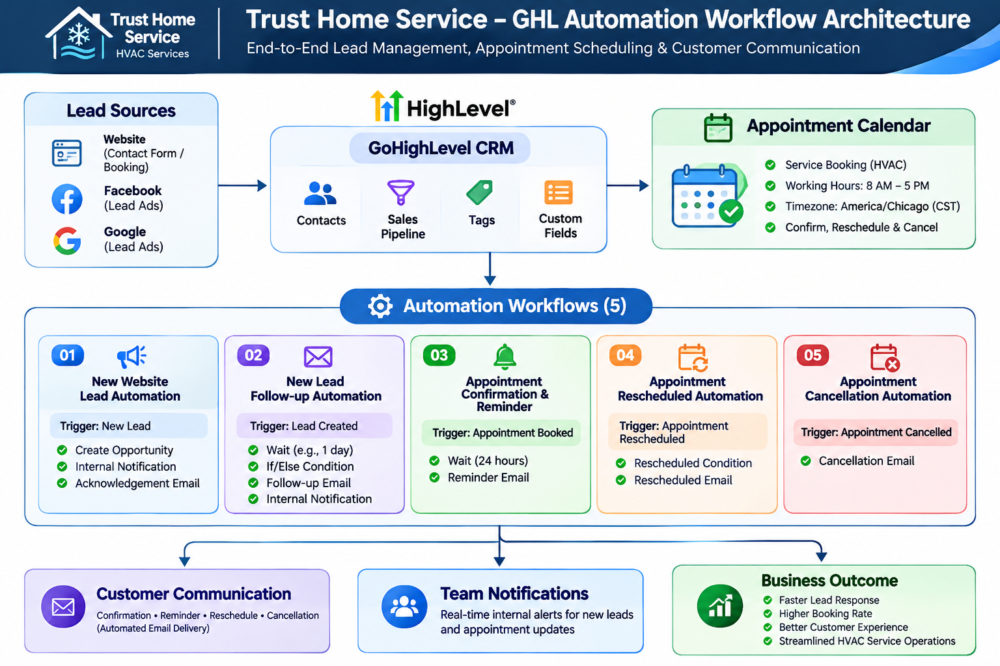

  <strong>A GoHighLevel CRM and Workflow Automation Demo for HVAC & Home Service Businesses</strong>

  
  
  
  

  <em>Automating lead management, customer follow-ups, appointment scheduling, and email communication.</em>

---

## 📌 Project Overview

**Trust Home Service** is a demonstration CRM and business automation system built using GoHighLevel (GHL) for a fictional HVAC and home service business based in Austin, Texas.

The project demonstrates how a home service business can organize customer information, manage sales opportunities, automate lead follow-ups, and handle appointment-related communications through structured CRM workflows.

The system includes:

- Centralized CRM and customer information management.
- Home Services Sales Pipeline.
- Contact and Opportunity custom fields.
- Lead source and service-related tags.
- Five automated workflows.
- HVAC service appointment calendar.
- Automated email communication.
- Internal team notifications.

> **Project Type:** Portfolio / Demonstration Project  
> **Business:** Fictional HVAC Service Business  
> **Platform:** GoHighLevel  
> **Timezone:** America/Chicago

## 🏗️ System Architecture

The following diagram illustrates the overall architecture and automation flow.

## 🛠️ Technology Stack

| Technology | Purpose |
|---|---|
| GoHighLevel (GHL) | CRM and automation platform |
| GHL Workflows | Business process automation |
| GHL Calendars | Appointment scheduling |
| GHL Custom Fields | Structured customer and opportunity data |
| Email Automation | Customer communication |
| GHL Pipeline | Lead and opportunity management |

## 🗂️ CRM Configuration

### 1. Sales Pipeline

**Pipeline:** `Home Services Sales Pipeline`

Used to organize HVAC service opportunities and track leads through the sales process.

### 2. Contact Custom Fields

| Field | Type |
|---|---|
| Property Address | Multi Line |
| Preferred Contact Method | Dropdown |
| Follow-up Status | Dropdown |

### 3. Opportunity Custom Fields

| Field | Type |
|---|---|
| Service Type | Dropdown |
| Service Urgency | Dropdown |
| Estimated Budget | Monetary |
| Preferred Appointment Date | Date Picker |

### 4. CRM Tags

**Lead Sources**
- `source_website`
- `source_facebook`
- `source_google`

**Service Categories**
- `service_hvac`
- `service_plumbing`

**Urgency**
- `urgency_emergency`
- `urgency_normal`

**Customer Status**
- `customer_new`

## ⚙️ Automated Workflows

Five workflows were configured and published in GoHighLevel.

### Workflow 01 – New Website Lead Automation

**Trigger:** Contact Tag Added → `source_website`

**Actions:**
1. Create HVAC Opportunity.
2. Send Internal Notification.
3. Send Lead Acknowledgement Email.

**Objective:** Automatically register a new website lead, create a sales opportunity, and acknowledge the enquiry.

### Workflow 02 – New Lead Follow-up Automation

**Trigger:** Contact Tag Added → `source_website`

**Actions:**
1. Wait for 1 hour.
2. Check Follow-up Status using If/Else.
3. Send Follow-up Email when the status is `Not Contacted`.
4. Wait for 24 hours.
5. Send Internal Follow-up Reminder Notification.

**Objective:** Reduce missed enquiries and support timely lead follow-ups.

### Workflow 03 – Appointment Confirmation & Reminder Automation

**Trigger:** Appointment Status → Confirmed appointment in the HVAC Service Calendar.

**Actions:**
1. Wait until 24 hours before the appointment.
2. Send Appointment Reminder Email.

**Objective:** Remind customers about upcoming HVAC service appointments.

**Testing note:** The email action was tested using a temporary 1-minute wait. The production configuration was restored to 24 hours. Full 24-hour timing was not independently verified.

### Workflow 04 – Appointment Rescheduled Automation

**Trigger:** Appointment Status event in the HVAC Service Calendar.

**Condition:** Appointment → Rescheduled is True.

**Actions:**
1. Evaluate the rescheduled condition.
2. Send Appointment Rescheduled Email.

**Objective:** Notify customers when their service appointment is rescheduled.

**Testing result:** The rescheduled condition, email action, and workflow execution were verified through GHL execution logs and email delivery statistics.

### Workflow 05 – Appointment Cancellation Automation

**Trigger:** Appointment Status → Cancelled in the HVAC Service Calendar.

**Actions:**
1. Send Appointment Cancellation Email.

**Objective:** Notify customers when an HVAC service appointment is cancelled.

**Testing result:** Workflow execution and email delivery statistics were verified.

## 📅 Appointment Calendar Configuration

**Calendar Name:** `Trust Home Service - HVAC Service Calendar`

| Configuration | Setting |
|---|---|
| Calendar Type | Personal Booking Calendar |
| Assigned Team Member | Aminul Islam |
| Meeting Duration | 30 Minutes |
| Timezone | America/Chicago |
| Working Days | Monday – Friday |
| Working Hours | 8:00 AM – 5:00 PM |
| Minimum Scheduling Notice | 2 Hours |
| Booking Date Range | 30 Days |
| Pre/Post Buffer | 15 Minutes |
| Maximum Bookings Per Day | 8 |
| Maximum Bookings Per Slot | 1 |
| Auto-confirmation | Enabled |
| Rescheduling | Enabled |
| Cancellation | Enabled |

**Calendar capabilities:**
- HVAC service appointment booking.
- Appointment confirmation.
- Appointment rescheduling.
- Appointment cancellation.
- Email and in-app notifications.
- Booking confirmation page.

## 🧪 Testing & Validation

The following areas were tested during the demonstration project.

| Test Area | Validation |
|---|---|
| CRM Contact Creation | Tested |
| Opportunity Creation | Tested |
| Lead Acknowledgement Email | Delivery verified |
| Lead Follow-up Email | Delivery verified |
| Internal Notifications | Tested |
| Appointment Booking | Tested |
| Appointment Reminder Email | Tested with temporary 1-minute wait |
| Appointment Rescheduling | Execution and delivery statistics verified |
| Appointment Cancellation | Execution and delivery statistics verified |
| Workflow Publishing | All five workflows published |

**Testing limitations:**
- The full 24-hour reminder timing was not independently verified.
- Third-party Google, Outlook, or iCloud calendar synchronization was not independently verified.
- Some workflow email delivery results were verified through GHL Statistics rather than separate Gmail inbox content.
- This is a demonstration environment, not a live production deployment.

## 📸 Project Screenshots

### CRM & Configuration

| Screenshot | Description |
|---|---|
| CRM Pipeline | Sales pipeline configuration |
| Custom Fields | Contact and Opportunity fields |
| Tags | Lead source and service tags |

### Automation Workflows

**Workflow 01 – New Website Lead Automation**

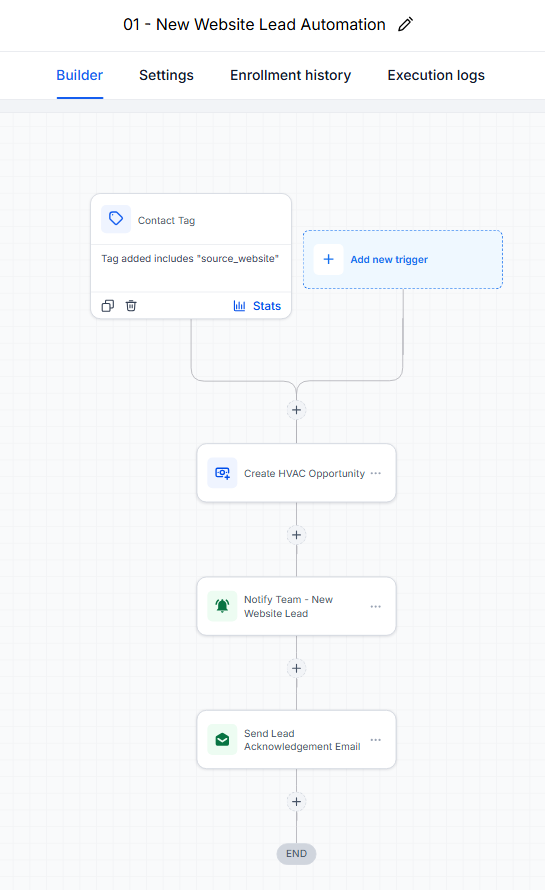

**Workflow 02 – New Lead Follow-up Automation**

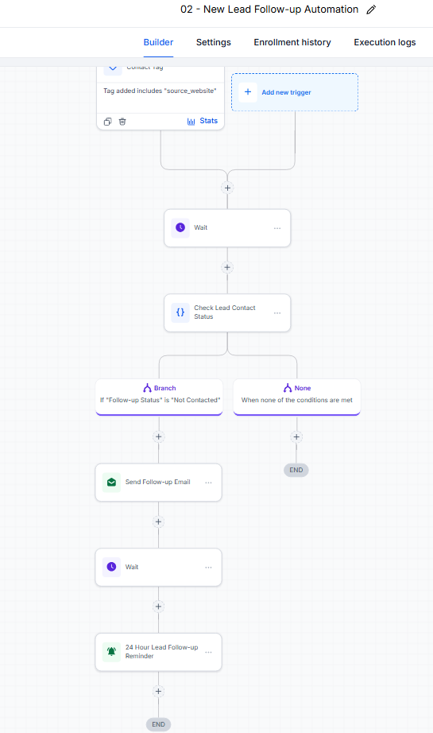

**Workflow 03 – Appointment Confirmation & Reminder**

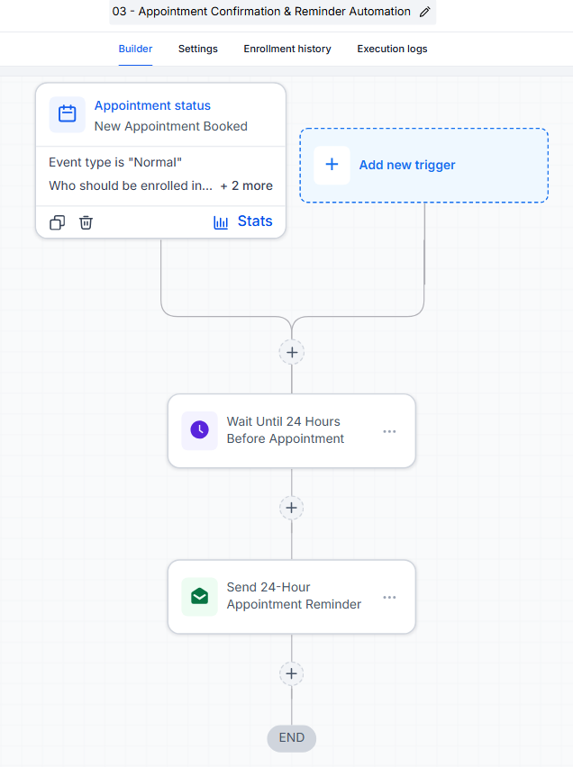

**Workflow 04 – Appointment Rescheduled Automation**

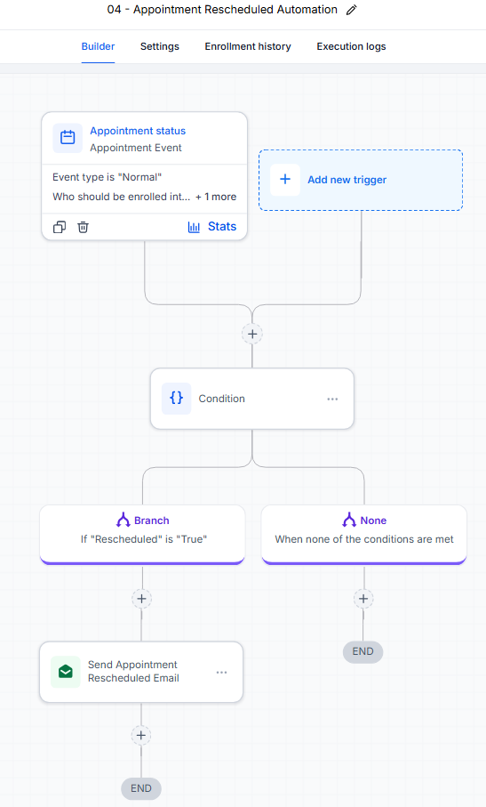

**Workflow 05 – Appointment Cancellation Automation**

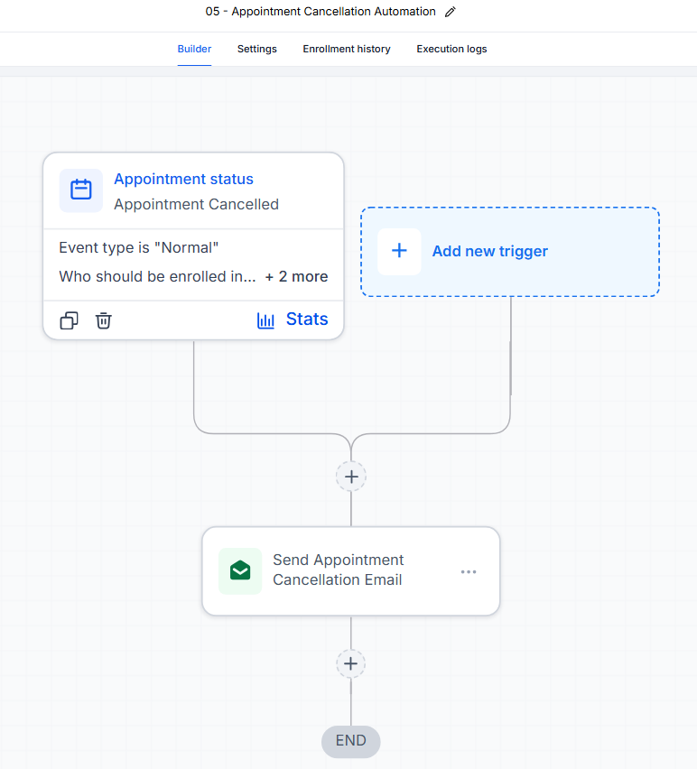

### Appointment Management

**Calendar Availability**

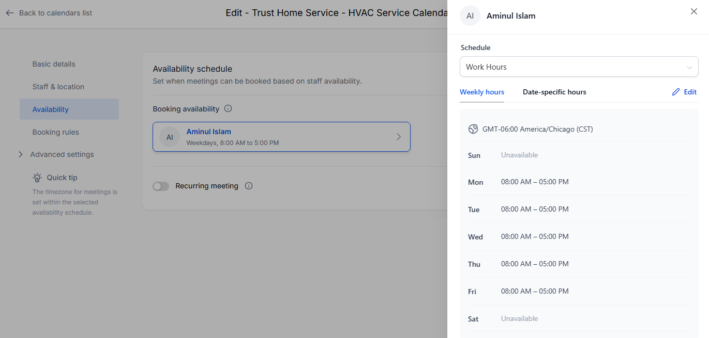

**Booking Widget**

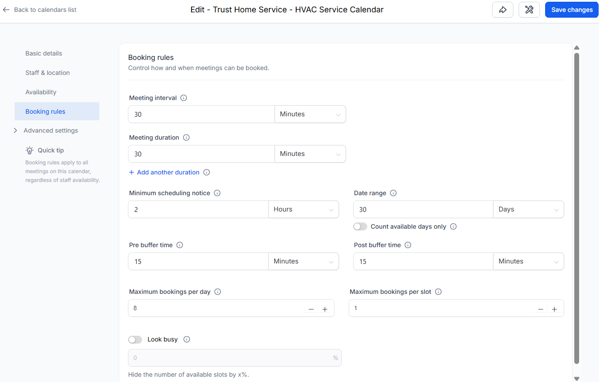

**Appointment Management**

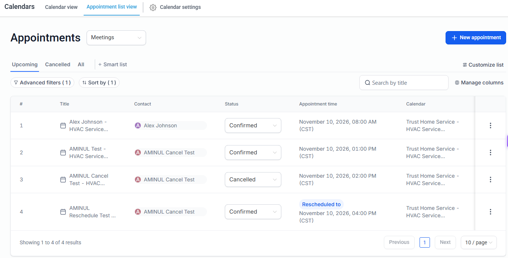

### Testing Evidence

**Workflow Execution Logs**

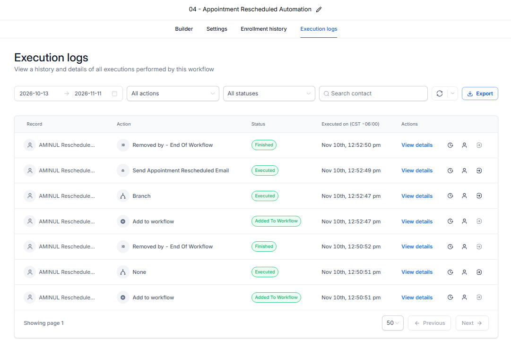

**Email Delivery Statistics**

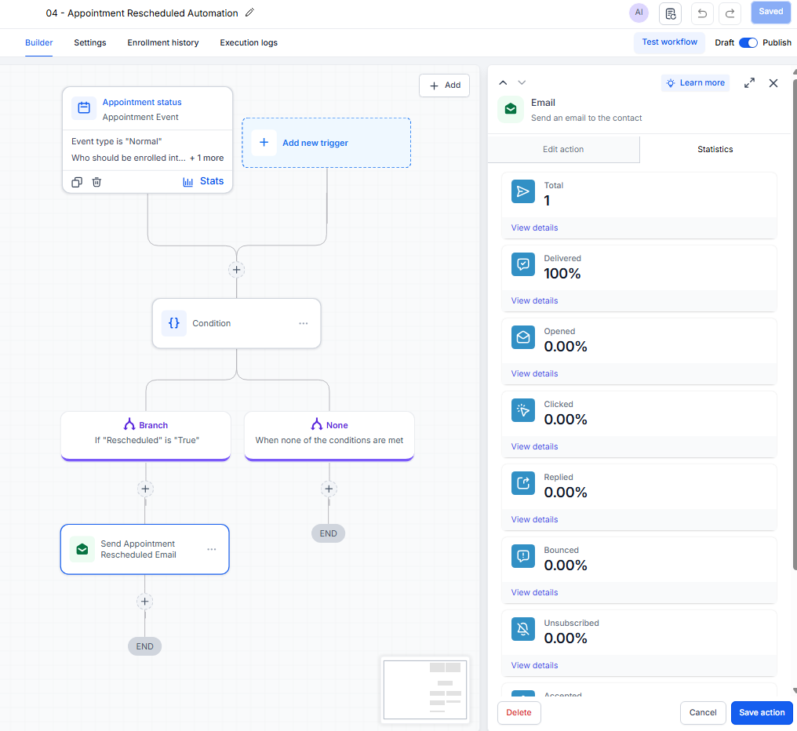

**Email Evidence**

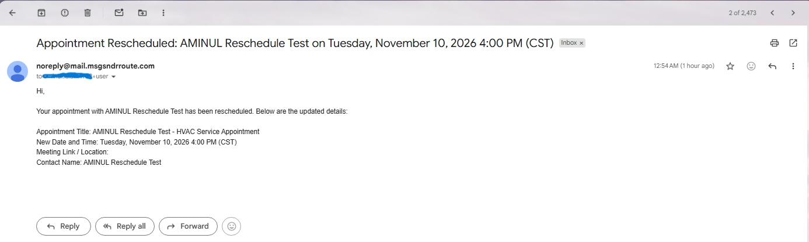

## 🚀 Business Benefits

This demonstration illustrates how workflow automation can help home service businesses:

- Respond to new customer enquiries faster.
- Organize leads and opportunities centrally.
- Reduce manual follow-up tasks.
- Improve appointment communication.
- Reduce missed appointment notifications.
- Maintain a more structured customer journey.

## 🔮 Future Enhancements

Potential improvements for a future version:

- AI-powered lead qualification.
- AI chatbot for customer enquiries.
- AI Voice Agent for inbound calls.
- SMS and WhatsApp automation.
- Technician assignment and dispatch automation.
- Service completion and feedback workflows.
- Invoice and payment integration.
- Advanced reporting dashboards.
- n8n and external REST API integrations.

*These are proposed enhancements and are not part of the current implementation.*

## 🔐 Security & Privacy

- Test customer information should be masked in public screenshots.
- API keys, passwords, and credentials must never be committed to the repository.
- Use secure authentication and access controls when integrating external services.

## 👨‍💻 Author

**Aminul Islam**

Software Developer | Oracle APEX | AI Automation Engineer

Interested in CRM Automation, AI Agents, API Integration, and Enterprise Application Development.

  <strong>Building practical automation solutions for modern businesses.</strong>

---

  Portfolio Demonstration Project · Trust Home Service · 2026

